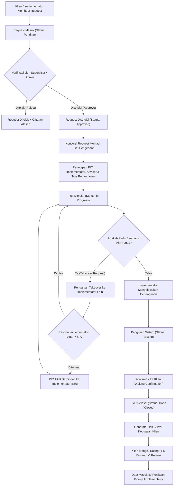
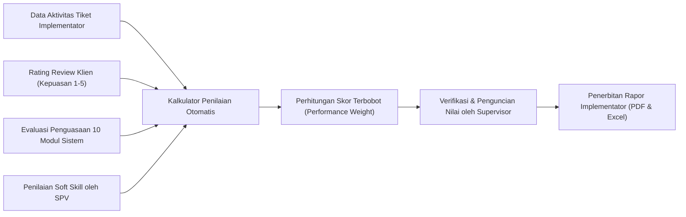
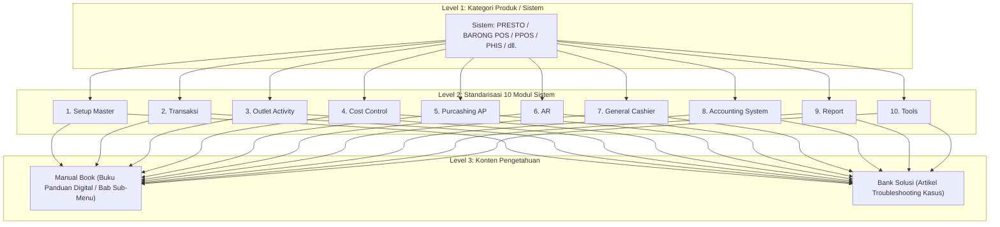
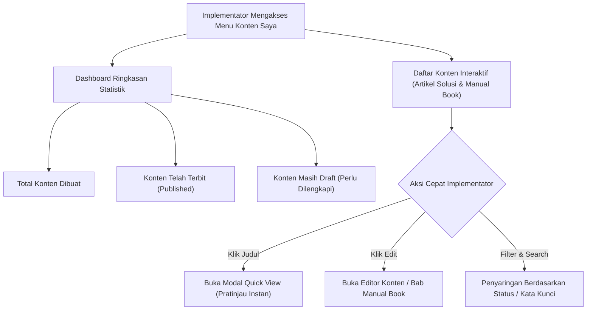

# 📘 Alur Proses Sistem Probus Implementator & Help Center
**CV. Mitra Solusi Mandiri (Probus System)**

---

## 📌 1. Pendahuluan & Gambaran Umum Sistem

Sistem **Probus Implementator & Help Center** adalah platform terpadu berbasis web yang dirancang untuk mendukung operasional tim implementasi, technical support, dan manajemen Probus System dalam memberikan layanan prima kepada klien (hotel, restoran, outlet F&B, dan unit bisnis lainnya).

Platform ini mengintegrasikan 5 (lima) pilar operasional utama:
1. **Request Management**: Pengelolaan permintaan bantuan, kendala sistem, atau fitur baru dari klien.
2. **Ticketing & Taskforce Handling**: Penugasan, eksekusi teknis, takeover penanganan, dan pelacakan SLA pengerjaan tiket.
3. **Performance Review & Rapor Kinerja**: Evaluasi terukur kinerja implementator berdasarkan durasi penanganan, rating kepuasan klien, penguasaan modul, dan soft skill.
4. **Knowledge Base (Bank Solusi & Manual Book)**: Dokumentasi panduan modul terstandarisasi (10 Modul Utama) serta repositori solusi pemecahan masalah teknis.
5. **System Updates & Release Tracking**: Dokumentasi riwayat rilis pembaruan perangkat lunak per produk sistem.

---

## 👥 2. Peran Pengguna & Hak Akses (User Roles & Matrix)

Sistem membagi pengguna ke dalam 4 (empat) entitas peran:

| Peran (Role) | Hak Akses Utama | Tanggung Jawab Operasional |
| :--- | :--- | :--- |
| **Admin** | Akses penuh (*super user*), manajemen akun, master data bobot penilaian, master modul sistem, dan audit log. | Mengatur konfigurasi global, hak akses, persetujuan tingkat lanjut, dan stabilitas sistem. |
| **Supervisor (SPV)** | Menyetujui request, menugaskan tiket, memvalidasi takeover, menilai performa implementator, membuka/mengunci penilaian. | Memantau SLA, mengontrol beban kerja implementator, menjaga mutu penanganan, dan mengevaluasi rapor kinerja. |
| **Implementator / Staff Support** | Menerima dan mengerjakan tiket, diskusi solusi, mengajukan/menerima takeover, menyusun artikel Bank Solusi dan buku panduan Manual Book. | Melakukan investigasi teknis, perbaikan sistem (remote/onsite/office), dan mendokumentasikan panduan operasional. |
| **Klien / Outlet (Publik)** | Mengajukan request bantuan, memantau progres tiket secara *live* tanpa login, memberikan ulasan kepuasan (Rating bintang 1-5). | Melaporkan kendala operasional outlet dan memberikan feedback hasil penanganan implementator. |

---

## 🔄 3. Alur Siklus Layanan Permintaan & Penanganan Tiket

Berikut adalah alur lengkap sejak kendala dilaporkan oleh klien hingga tiket ditutup dan dinilai:



### Penjelasan Tahapan:
1. **Pengajuan Request (`/createrq`)**:
   - Klien atau implementator mengisi formulir keluhan: memilih **Outlet**, **Kategori Sistem** (misal *PRESTO, BARONG POS, PPOS*), **Modul Sistem**, deskripsi kendala, serta melampirkan screenshot/foto bukti kendala.
   - Klien menerima tautan pelacakan publik (`/track/request/{id}`) untuk memantau status secara langsung tanpa login.
2. **Verifikasi & Persetujuan (`Request Approval`)**:
   - Supervisor meninjau validitas request. Jika tidak valid/duplikat, request dapat ditolak dengan memberikan alasan penolakan.
   - Request yang valid disetujui (`Approved`) dan dialihkan menjadi **Tiket Kerja** (`Convert to Ticket`).
3. **Penetapan Penanganan (`Ticket Assignment`)**:
   - Ditentukan **Implementator Utama (PIC)**, **Advisor** (rekan pendamping/konsultan teknis jika dibutuhkan), dan **Tipe Penanganan**:
     - *Remote*: Pengerjaan jarak jauh via AnyDesk, TeamViewer, UltraViewer.
     - *Office*: Pengerjaan dari kantor Probus (investigasi basis data / script query).
     - *On Site / Visit*: Kunjungan langsung ke lokasi outlet klien.
4. **Pengerjaan & Diskusi Interaktif**:
   - Implementator mengubah status menjadi `In Progress`. Sistem mulai mencatat durasi waktu penanganan.
   - Fitur **Diskusi Tiket** digunakan untuk bertukar pesan, instruksi, dan bukti tangkapan layar antara implementator dan tim support internal.
5. **Mekanisme Alih Tugas (Takeover Tiket)**:
   - Jika implementator berhalangan (jadwal kunjungan bentrok, spesialisasi modul berbeda), ia dapat mengajukan *Takeover Request* ke implementator lain disertai alasan.
   - Implementator penerima atau supervisor dapat menerima (`Accept`) atau menolak (`Reject`) permintaan takeover tersebut. Riwayat takeover dicatat lengkap dalam log audit.
6. **Penyelesaian & Survei Kepuasan**:
   - Setelah penanganan berhasil diuji (`Testing`), tiket ditandai sebagai `Selesai (Closed)`.
   - Sistem secara otomatis menyediakan tautan review publik: `/review/{ticket_number}`. Klien dapat memberikan ulasan tertulis serta rating bintang 1 hingga 5.

---

## 📊 4. Alur Evaluasi Kinerja & Rapor Implementator

Sistem dilengkapi modul evaluasi terukur untuk menilai produktivitas dan kualitas pelayanan setiap implementator secara berkala (bulanan/tahunan).



### Komponen Penilaian Terbobot:
1. **Kecepatan & Ketepatan Tiket (Durasi & Volume)**:
   - Jumlah tiket yang diselesaikan dan rata-rata durasi pengerjaan sesuai batasan SLA.
2. **Indeks Kepuasan Klien (Rating Survei)**:
   - Rata-rata bintang kepuasan yang diberikan oleh pihak outlet/klien atas penanganan implementator.
3. **Penguasaan Modul Sistem**:
   - Akurasi pemecahan masalah pada modul-modul spesifik (Setup Master, Transaksi, Accounting, Tools, dll.).
4. **Soft Skill & Sikap Kerja**:
   - Dinilai oleh Supervisor meliputi aspek: Komunikasi dengan Klien, Inisiatif & Tanggung Jawab, Kerjasama Tim, serta Kedisiplinan.
5. **Output Rapor**:
   - Rapor kinerja dapat diunduh dalam format resmi **PDF** dan **Excel**, dilengkapi rekap tiket dan grafik kompetensi modul.

---

## 📚 5. Alur Knowledge Base: Standarisasi Modul, Manual Book & Bank Solusi

Knowledge Base Probus dibagi menjadi 2 (dua) subsistem utama yang saling terhubung:



### A. Standarisasi 10 Modul Sistem (`menu_systems`)
Untuk memastikan konsistensi dokumentasi di seluruh produk software Probus, setiap sistem wajib menggunakan urutan 10 modul standar:
1. **Setup Master**: Konfigurasi parameter outlet, master menu, user privilege, dan master data dasar.
2. **Transaksi**: Operasional kasir POS, reservasi, order taker, split bill, dan pemrosesan pembayaran.
3. **Outlet Activity**: Operasional harian outlet, open/close shift kasir, dan ringkasan aktivitas kasir.
4. **Cost Control**: Resep standar, food & beverage cost, kontrol persediaan bahan baku, dan analisa selisih *waste*.
5. **Purcashing AP**: Purchase Request (PR), Purchase Order (PO), penerimaan barang (Receiving), dan hutang usaha.
6. **AR**: Piutang pelanggan (Accounts Receivable), penagihan invoice, city ledger, dan rekonsiliasi pembayaran tempo.
7. **General Cashier**: Kasir kantor pusat/umum, penerimaan kas harian, pengeluaran kas kecil (*petty cash*).
8. **Accounting System**: Jurnal umum, buku besar (GL), neraca, rugi laba, dan laporan keuangan komprehensif.
9. **Report**: Pusat laporan analitik, laporan penjualan harian/bulanan, tren penjualan menu, dan ringkasan pajak.
10. **Tools**: Utilitas pendukung, pengaturan printer kasir, koneksi perangkat dapur, drawer, dan sinkronisasi database.

### B. Alur Pengelolaan Manual Book (`/manual-book`)
1. **Penyusunan Bab Panduan**:
   - Ditulis langsung menggunakan **Rich Text Editor (TinyMCE)** dengan dukungan format teks tebal, daftar bernomor, tabel terstruktur, dan penempelan gambar (*drag & drop image upload*).
2. **Fitur Unggulan Import Dokumen Word (`.docx`)**:
   - Implementator dapat mengunggah file panduan `.docx`.
   - Parser sistem (`DocxParser`) secara otomatis mengekstrak seluruh teks, susunan tabel, dan gambar yang ada di dalam file Word, lalu mengonversinya menjadi dokumen web HTML siap pakai.
3. **Pengaturan Urutan Bab**:
   - Urutan sub-menu dapat diatur ulang secara fleksibel (*Reorder Sub Menu*).
4. **Status & Audit Trail**:
   - Status bab: `Draft` (hanya terlihat oleh internal pembuat) dan `Published` (terbit dan dapat dibaca semua staf).
   - Setiap perubahan dicatat ke dalam `manual_book_logs` mencakup identitas pengubah dan waktu suntingan terakhir.

### C. Alur Bank Solusi (`/bank-solusi`)
1. Implementator yang berhasil memecahkan kendala unik membuat artikel troubleshooting di Bank Solusi.
2. Menghubungkan artikel dengan sistem dan modul terkait, serta menyematkan label (`Tags`) untuk memudahkan pencarian cepat saat implementator lain menghadapi kasus serupa di lapangan.
3. Fitur *Quick View Modal* memungkinkan implementator membaca artikel solusi dan panduan manual book tanpa berpindah halaman kerja.

---

## 💼 6. Ruang Kerja Implementator: Konten Saya (`/konten-saya`)

Halaman **Konten Saya** adalah ruang kerja personal bagi setiap implementator untuk mengelola materi dokumentasi yang telah mereka susun:



---

## 🛠️ 7. Siklus Pembaruan Sistem (Update System / Patch Release)

Ketika tim pengembang merilis pembaruan perangkat lunak Probus untuk mengatasi request klien atau menyempurnakan fitur:

1. **Pembuatan Catatan Update (`/createus/{id}`)**:
   - Menghubungkan rilis update dengan tiket/request yang relevan.
   - Memilih kategori sistem yang diperbarui.
   - Mengisi deskripsi perbaikan/fitur baru, versi rilis, dan mengunggah paket patch / file executable pendukung.
2. **Publikasi & Log Perubahan**:
   - Tersimpan di menu **Master Update System (`/mus`)** sebagai acuan implementator lapangan saat melakukan instalasi pembaruan di outlet klien.

---

## 🔔 8. Sistem Notifikasi & Audit Log

- **Notifikasi Terintegrasi**: Mengirimkan pemberitahuan otomatis ketika:
  - Terdapat request bantuan baru dari outlet.
  - Tiket baru ditugaskan ke implementator.
  - Terjadi permintaan alih tugas (*takeover*) tiket.
  - Terdapat tanggapan atau komentar baru dalam diskusi tiket.
- **Audit Log (`ActivityLog`)**: Mencatat setiap perubahan data penting (login, status tiket, penilaian, perubahan konten panduan) untuk menjamin transparansi operasional tim.

---

## 📌 Ringkasan Integrasi Modul

```
[ Klien / Outlet ]
       │
       ▼ (Request Kendala)
[ Request Management ] ──(Approved)──► [ Ticketing System ]
                                              │
             ┌────────────────────────────────┴────────────────────────────────┐
             ▼                                                                 ▼
   [ Investigasi Teknis ]                                            [ Knowledge Base ]
 (Remote / Office / Visit)                                          (Manual Book & Bank Solusi)
             │                                                                 ▲
             ▼                                                                 │
    [ Tiket Selesai ] ──(Dokumentasi Panduan / Solusi)─────────────────────────┘
             │
             ├──► [ Review Kepuasan Klien (Rating 1-5) ]
             │
             ▼
[ Performance Review & Rapor Kinerja Implementator ]
```

---
*Dokumen ini dibuat secara otomatis dan diselaraskan dengan struktur kode sumber, database, dan alur operasional aktif pada proyek Probus Implementator 2026.*

