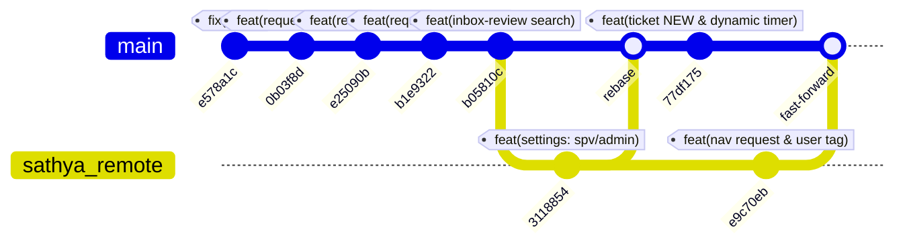

# Ringkasan Pekerjaan & Pengembangan Sistem (13 Oktober 2026)

Dokumen ini merangkum seluruh pekerjaan, implementasi fitur, perbaikan *bug*, pembaruan antarmuka (UI/UX), migrasi database, dan sinkronisasi Git yang telah diselesaikan pada tanggal **13 Oktober 2026** di repositori **Probus Implementator 2026**.

---

## 1. Ikhtisar & Highlight Utama Hari Ini

| Area / Modul | Status | Ringkasan Pekerjaan |
| :--- | :--- | :--- |
| **Form Update System (Create & Edit)** | Selesai | Desain ulang UI form yang lebih rapi & modern, penyesuaian tombol utama menggunakan warna biru (`bg-blue-600`), serta migrasi agar field `link_exe` bersifat opsional (*nullable*). |
| **Penanda "NEW" pada Tiket** | Selesai | Implementasi penanda visual badge **NEW** pada tiket yang baru dibuat (< 24 jam) dan tiket yang baru dikembalikan (*returned*) oleh PIC/supervisor, dengan filter kondisi presisi agar tiket lama tidak keliru berlabel NEW. |
| **Batas Waktu Alih Tiket Dinamis** | Selesai | Pengaturan durasi tunggu alih tiket (*takeover duration*) fleksibel dengan opsi cepat (15m, 30m, 1j, 2j) dan opsi menit kustom (*custom minutes*), terhubung langsung dengan *countdown timer*. |
| **Perbaikan Modal & Submit Bug** | Selesai | Penyelarasan teks tombol modal menjadi **"Oke"** serta perbaikan bug submit durasi kustom (15 menit) agar tiket langsung terkirim dan status terbarui dengan benar. |
| **Restrukturisasi Halaman History** | Selesai | Memindahkan tab riwayat tiket dan *update system* dari halaman profil ke rute/halaman navigasi khusus **History** (`/history`), sehingga profil tetap fokus pada data akun. |
| **Integrasi & Sinkronisasi Git** | Selesai | Rebase dan merge perubahan tim, push ke remote `sathya` dan `origin`, serta pull update terbaru navigasi Request System secara bersih (*fast-forward*). |

---

## 2. Rincian Fitur & Peningkatan Teknis

### A. Redesain Form Create & Edit Update System (`tableus/createus`, `tableus/editus`)
- **Tampilan UI**: Form dirombak menggunakan struktur kartu (*card*) modern dengan *spacing* rapi, *typography* jelas, dan *rounded border*.
- **Warna Tombol**: Menggunakan tema warna biru elegan (`bg-blue-600 hover:bg-blue-700 focus:ring-blue-500`) sesuai permintaan desain.
- **Fungsionalitas `link_exe`**:
  - Difungsikan untuk menyimpan URL file unduhan installer/pembaruan sistem aplikasi.
  - Dibuatkan migrasi database `2026_10_13_070000_make_link_nullable_in_updatesystem_table.php` agar field ini tidak wajib diisi jika pembaruan belum memiliki link installer.

---

### B. Badge Penanda "NEW" pada Tiket
- **Latar Belakang**: Pengguna membutuhkan tanda visual yang jelas untuk membedakan tiket yang baru masuk dari klien dan tiket yang baru saja dikembalikan oleh tim pelaksana ke antrean.
- **Logika Penanda**:
  - Tiket baru dibuat: status `open`/`waiting` dengan waktu pembuatan kurang dari 24 jam (`created_at >= now()->subDay()`).
  - Tiket baru dikembalikan: memiliki catatan `returned_at` dalam 24 jam terakhir.
  - Tiket yang sudah diproses atau tiket lama tidak lagi menampilkan label NEW.
- **Migrasi**: `2026_10_13_080000_add_returned_at_to_tickets_table.php` menambahkan kolom `returned_at` (nullable timestamp) pada tabel `tickets`.
- **Integrasi View**: Diterapkan seragam pada:
  - `resources/views/daftartiket.blade.php`
  - `resources/views/inbox.blade.php`
  - `resources/views/partials/dashboard_tickets.blade.php`

---

### C. Pengaturan Batas Waktu Alih Tiket Fleksibel (*Custom Waiting Duration*)
- **Sebelumnya**: Batas waktu tunggu tiket dialihkan (*takeover*) selalu kaku 1 jam (60 menit).
- **Pembaruan**:
  - Modal alih tiket di [`detailticket.blade.php`](file:///c:/Users/USER/Downloads/probus-implementator-main/resources/views/tablerq/detailticket.blade.php) kini menyediakan pilihan durasi:
    - Opsi Preset: **15 Menit**, **30 Menit**, **1 Jam**, **2 Jam**.
    - Opsi Kustom: Input angka menit secara bebas sesuai kebutuhan operasional.
  - Tombol popup kustom diseragamkan menggunakan teks **"Oke"**.
  - **Perbaikan Bug Submit**: Memperbaiki event form submit pada opsi custom 15 menit sehingga input durasi terbawa dengan benar ke controller dan tiket berhasil terkirim tanpa macet di status awal.
- **Migrasi**: `2026_10_13_090000_add_takeover_duration_to_tickets_table.php` menambahkan kolom `takeover_duration` (integer menit) pada tabel `tickets`.
- **Countdown Timer**: Script hitung mundur di halaman detail tiket dan background command disinkronkan untuk menghitung sisa waktu berdasarkan `pending_advisor_at` ditambah `takeover_duration`.

---

### D. Pemisahan Halaman History dari Profil User
- **Alur Baru**:
  - Halaman **Profil** difokuskan untuk informasi personal user, ganti foto, dan ubah kata sandi.
  - Disediakan rute dedicated [`/history`](file:///c:/Users/USER/Downloads/probus-implementator-main/routes/web.php) yang mengarahkan ke dashboard riwayat tiket dan *update system* yang pernah ditangani user.
  - Sidebar diperbarui dengan menu navigasi **History** agar mudah diakses.

---

## 3. Daftar Migrasi Database Baru Hari Ini

1. [`2026_10_13_023000_merge_urgent_status_into_open.php`](file:///c:/Users/USER/Downloads/probus-implementator-main/database/migrations/2026_10_13_023000_merge_urgent_status_into_open.php)
   - Mengalihkan status lama *urgent* ke dalam *open*, menyederhanakan siklus status menjadi 3: *Open*, *Progress*, dan *Closed*.
2. [`2026_10_13_070000_make_link_nullable_in_updatesystem_table.php`](file:///c:/Users/USER/Downloads/probus-implementator-main/database/migrations/2026_10_13_070000_make_link_nullable_in_updatesystem_table.php)
   - Mengubah kolom `link` di tabel `updatesystem` menjadi `nullable()`.
3. [`2026_10_13_080000_add_returned_at_to_tickets_table.php`](file:///c:/Users/USER/Downloads/probus-implementator-main/database/migrations/2026_10_13_080000_add_returned_at_to_tickets_table.php)
   - Menambahkan kolom `returned_at` (nullable timestamp) pada tabel `tickets` untuk pelacakan tiket yang dikembalikan.
4. [`2026_10_13_090000_add_takeover_duration_to_tickets_table.php`](file:///c:/Users/USER/Downloads/probus-implementator-main/database/migrations/2026_10_13_090000_add_takeover_duration_to_tickets_table.php)
   - Menambahkan kolom `takeover_duration` (integer, default 60 menit) pada tabel `tickets`.

---

## 4. Rekapitulasi Commit & Sinkronisasi Git

### Log Commit Hari Ini:
1. `e9c70eb` - *feat: perbarui navigasi menu request system dan perbaiki tag user pada register/edit acc* (dari remote `sathya`)
2. `77df175` - *feat(ticket): tambahkan penanda NEW tiket dan pengaturan batas waktu alih tiket dinamis*
3. `3118854` - *feat(settings): batasi akses modul pengaturan hanya untuk supervisor dan admin* (dari remote `sathya`)
4. `b05810c` - *feat(inbox-review): tambahkan responsive search bar di inbox dan perbaiki target review tiket*
5. `b1e9322` - *feat(request): implementasi request dashboard dan penyelarasan form create request sesuai sistem ticket*
6. `e25090b` - *feat(request): perbarui route detailrequest, kunci request closed, perbaiki tombol proses request dan tombol kembali*
7. `0b03f8d` - *feat(request): hilangkan status urgent dan alihkan ke status open (3 status: open, progress, closed)*
8. `e578a1c` - *fix(inbox): fetch systems filter from Kategori and improve dropdown spacing*

### Status Remote Saat Ini:
- Branch: `feature/mobile-inbox-and-ticket-improvements`
- Remote `sathya`: Sinkron dan up-to-date (`e9c70eb`)
- Remote `origin`: Sinkron dan up-to-date (`e9c70eb`)
- Working tree: Bersih (*clean*).
